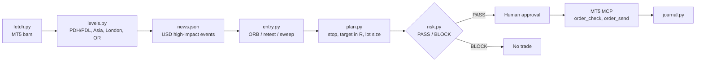
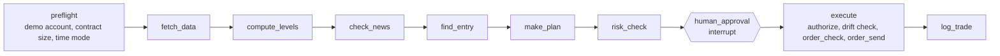

# XAUUSD Day Trader

A New York-session gold (XAUUSD) trading toolkit for MetaTrader 5, built to be driven by an LLM agent through an MT5 MCP server. The deterministic code (levels, entries, position sizing, risk gate, backtest, journal) is separate from the LLM, so the model can reason about the market but cannot override the risk rules.

> **Disclaimer:** This is a personal research and engineering project, not financial advice. Trading leveraged instruments can lose more than you deposit. Use a demo account. Backtests show what rules did on past data, not what they will do.

## Design principles

- **Deterministic core, LLM on top.** Sizing, stops and the risk gate are plain Python and unit-tested. An agent calls them as tools; it never computes lot sizes itself.
- **Fail closed.** No order is sent unless all three hold: `risk.py` printed PASS for this exact plan (hash-bound), the user explicitly approved this exact ticket, and the MCP order tool was approved in the client.
- **Refuse instead of bending the rules.** If the minimum lot would exceed the max loss, the planner refuses. It never rounds up.
- **Honest backtesting.** Spread is modelled on entry and stop, a stop and target in the same bar counts as a stop, and a bootstrap shows whether the average R could plausibly be zero.

## Workflow



All times are New York time. Broker server time is converted using configurable winter/summer offsets, with US DST handled in code.

## LangGraph agent

`gold-agent` runs the same workflow as a [LangGraph](https://langchain-ai.github.io/langgraph/) state machine. Each step is a node; any node can end the run with an outcome (`NO_SIGNAL`, `REFUSED`, `BLOCKED`, `PRICE_MOVED`, ...).



Safety properties, all enforced by deterministic code in [`agent/guard.py`](src/xauusd_trader/agent/guard.py) and covered by tests:

- **Human in the loop.** `human_approval` uses LangGraph `interrupt()`. The run pauses on the exact ticket and resumes only with an approval carrying that ticket's hash.
- **Demo only.** Preflight refuses any account whose `trade_mode` is not demo, and `execute` checks again right before sending.
- **No unverified inputs.** Missing contract size, a broker lot-rule mismatch, a feed whose timestamps do not match the configured broker offset, stale bars, or a missing news file each stop the run.
- **Verdict bound to the plan.** The risk verdict carries a hash of the plan and expires; a changed plan or an old verdict is refused.
- **No chasing.** If the live price drifted more than half the stop distance since planning, nothing is sent.
- **Orders are built from the approved plan only.** Volume, stop and take-profit come straight from it; the model never composes an order.

### Where Claude is used (and where it is not)

| Feature | Flag | What the model does | What it cannot do |
|---|---|---|---|
| Ticket rationale | `--llm` | Explains the proposed trade in 3-4 sentences from computed numbers, shown beside the ticket | Change size, stop, target or approval: the text is outside the plan hash |
| Calendar research | `--llm-news` | Web-searches today's USD events (default: Sonnet) and adds them as blackout windows | Remove a blackout or approve anything: output is parsed into strictly validated `{time_ny, title}` events; malformed or out-of-range items are dropped, titles are length-capped. Labelled "not human-verified" |
| Journal review | `gold-review` | Reviews `journal.csv` from precomputed statistics and flags small samples | Compute or invent statistics |

If a model call fails, the run degrades safely: no rationale, or news falls back to `gold/news.json`. A failed research call never counts as a news check. Prompt-injection and "ignore the rules" cases are covered by tests with a scripted fake model, so CI never calls the API.

Put your key in `.env` (git-ignored; see `.env.example`):

```bash
cp .env.example .env     # then set ANTHROPIC_API_KEY
gold-agent --broker mcp --llm --llm-news
gold-review
```

The broker is an interface. `McpBroker` talks to [`mcp-metatrader5-server`](https://github.com/Qoyyuum/mcp-metatrader5-server) over stdio via `langchain-mcp-adapters` (one persistent session, never calls `login`); `PaperBroker` replays bars so everything is testable without MT5.

```bash
pip install -e ".[dev,agent]"
gold-agent --broker paper --data gold/data/M5.json --now "2026-02-02 09:25" --setups orb   # replay
gold-agent --broker mcp                                                                    # real MT5, demo account
```

## Strategy (summary)

| Setup | Idea |
|---|---|
| `orb` | First M5 close outside the 08:30-08:45 NY opening range |
| `retest` | After the break, a pullback to the range edge that closes back in the break direction |
| `sweep` | A poke beyond PDH/PDL or the Asian/London high/low that closes back inside; trade the reversal |

Stops and targets are in R (default 2R). Risk per trade defaults to 1% of balance, with a 2% daily loss limit, 3 trades per day max, a stop after 2 consecutive losses, and a news blackout around high-impact USD events. Details are in [`references/`](references/).

## Quick start

Requires Python 3.11+ (LangGraph's `interrupt()` does not work in async nodes on 3.10). The core toolkit uses only the standard library; the agent needs the `agent` extra and `fetch.py` needs the `MetaTrader5` package on Windows.

```bash
python -m venv .venv && source .venv/bin/activate    # Windows: .venv\Scripts\activate
pip install -e ".[dev]"          # add ",agent" for the LangGraph agent, ",mt5" to pull MT5 data directly

# try it without MT5 on synthetic data
python scripts/make_demo_data.py 150
python scripts/levels.py
python scripts/entry.py
python scripts/backtest.py --setups orb,retest,sweep
```

With a logged-in MT5 terminal:

```bash
cp config.example.json gold/config.json     # edit balance, symbol, broker offsets
python scripts/fetch.py --tf M5 --days 180
python scripts/levels.py
python scripts/entry.py
python scripts/plan.py --write
python scripts/risk.py
```

Personal data (`gold/`: config, journal, price data) is git-ignored. Set `GOLD_DIR` to use a different work directory.

## Tests

```bash
pytest -q
ruff check .
```

The suite covers time and DST conversion, level and entry logic, stop and lot sizing, every risk-gate rule, backtest fill ordering and journal statistics. CI runs on every push.

## Repository layout

```
src/xauusd_trader/   toolkit package (levels, entry, plan, risk, backtest, journal, fetch)
scripts/             thin launchers so `python scripts/<tool>.py` works without installing
references/          rules, risk, broker and backtest notes
tests/               pytest suite
SKILL.md             instructions that let an LLM client run the workflow
```

After `pip install -e .` each tool is also a command: `gold-levels`, `gold-entry`, `gold-plan`, `gold-risk`, `gold-journal`, `gold-backtest`, `gold-fetch`.

## License

MIT, see [LICENSE](LICENSE).

## Roadmap

- [x] Deterministic toolkit with tests and CI
- [x] LangGraph agent with `interrupt()` approval, MCP broker adapter and deterministic guard layer
- [x] Claude nodes: news research, trade rationale, journal review (explain and critique only; never size or send orders)
- [x] Adversarial tests: hostile model output cannot change an order or approve a ticket
- [ ] Position management after entry (flat-by time, journal close from MT5 history)
- [ ] Tracing (Langfuse / LangSmith) and a larger eval set across many replayed days
- [ ] Journal dashboard
- [x] Package refactor (`src/` layout, console commands)
- [ ] Typed config (pydantic) and friendlier CLI errors
