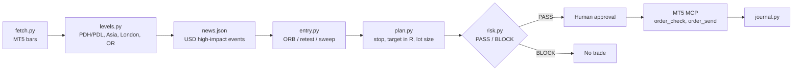

# XAUUSD Day Trader

A New York-session gold (XAUUSD) trading toolkit for MetaTrader 5, built to be driven by an LLM agent through an MT5 MCP server. The deterministic code (levels, entries, position sizing, risk gate, backtest, journal) is separate from the LLM, so the model can reason about the market but cannot override the risk rules.

> **Disclaimer:** This is a personal research and engineering project, not financial advice. Trading leveraged instruments can lose more than you deposit. Use a demo account. Backtests show what rules did on past data, not what they will do.

## Design principles

- **Deterministic core, LLM on top.** Sizing, stops and the risk gate are plain Python and unit-tested. An agent calls them as tools; it never computes lot sizes itself.
- **Fail closed.** No order is sent unless all three hold: `risk.py` printed PASS for this exact plan (hash-bound), the user explicitly approved this exact ticket, and the MCP order tool was approved in the client.
- **Refuse instead of bending the rules.** If the minimum lot would exceed the max loss, the planner refuses. It never rounds up.
- **Honest backtesting.** Spread is modelled on entry and stop, a stop and target in the same bar counts as a stop, and a bootstrap shows whether the average R could plausibly be zero.

## Workflow



All times are New York time. Broker server time is converted using configurable winter/summer offsets, with US DST handled in code.

## Strategy (summary)

| Setup | Idea |
|---|---|
| `orb` | First M5 close outside the 08:30-08:45 NY opening range |
| `retest` | After the break, a pullback to the range edge that closes back in the break direction |
| `sweep` | A poke beyond PDH/PDL or the Asian/London high/low that closes back inside; trade the reversal |

Stops and targets are in R (default 2R). Risk per trade defaults to 1% of balance, with a 2% daily loss limit, 3 trades per day max, a stop after 2 consecutive losses, and a news blackout around high-impact USD events. Details are in [`references/`](references/).

## Quick start

Requires Python 3.9+. The core scripts use only the standard library; `fetch.py` additionally needs the `MetaTrader5` package on Windows.

```bash
pip install -e ".[dev]"          # add ".[dev,mt5]" on Windows to pull MT5 data

# try it without MT5 on synthetic data
python scripts/make_demo_data.py 150
python scripts/levels.py
python scripts/entry.py
python scripts/backtest.py --setups orb,retest,sweep
```

With a logged-in MT5 terminal:

```bash
cp config.example.json gold/config.json     # edit balance, symbol, broker offsets
python scripts/fetch.py --tf M5 --days 180
python scripts/levels.py
python scripts/entry.py
python scripts/plan.py --write
python scripts/risk.py
```

Personal data (`gold/`: config, journal, price data) is git-ignored. Set `GOLD_DIR` to use a different work directory.

## Tests

```bash
pytest -q
ruff check .
```

The suite covers time and DST conversion, level and entry logic, stop and lot sizing, every risk-gate rule, backtest fill ordering and journal statistics. CI runs on every push.

## Repository layout

```
scripts/        toolkit (levels, entry, plan, risk, backtest, journal, fetch)
references/     rules, risk, broker and backtest notes
tests/          pytest suite
SKILL.md        instructions that let an LLM client run the workflow
```

## Roadmap

- [x] Deterministic toolkit with tests and CI
- [ ] LangGraph agent: `data -> levels -> news -> entry -> plan -> risk -> human approval -> order -> journal`, with `interrupt()` for approval and the MT5 MCP server as a tool via `langchain-mcp-adapters`
- [ ] LLM-assisted news research, trade rationale and post-trade review
- [ ] Tracing (Langfuse / LangSmith) and an eval set checking the agent never bypasses the risk gate
- [ ] Journal dashboard
- [ ] Package refactor (`src/` layout, typed config)
